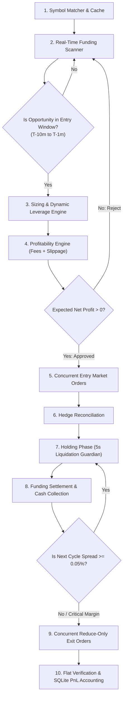

# Cross-Exchange Funding Arbitrage: Strategy & System Architecture

This document provides a simple, end-to-end explanation of the **Delta-Neutral Funding Arbitrage Strategy** and the autonomous trading engine built to execute it across **Binance Futures** and **Bybit Unified Perpetuals**.

---

## 1. What is Funding Arbitrage in Simple Terms?

In perpetual futures markets, exchanges do not have an expiration date. To keep the perpetual contract price pegged to the spot index price, exchanges enforce a **Funding Rate** payment between buyers (Longs) and sellers (Shorts) every 8 hours (00:00, 08:00, 16:00 UTC).

* When the funding rate is **positive** ($+$): **Longs pay Shorts**.
* When the funding rate is **negative** ($-$) : **Shorts pay Longs**.

Because Binance and Bybit operate with separate order books, market sentiment and funding rates frequently **diverge**:
* **Binance**: $+0.25\%$
* **Bybit**: $+0.02\%$
* **Funding Edge (Difference)**: $+0.23\%$ per 8 hours (**$251.85\%$ Annualized APR**)

---

## 2. How the Bot Makes Profit Without Market Risk (Delta-Neutral)

To collect this funding spread without taking any price direction risk, the bot opens two equal and opposite positions at the exact same moment:

```
┌────────────────────────────────────────────────────────┐
│                   THE ARBITRAGE TRADE                  │
│                                                        │
│   Binance (+0.25% Rate):   SHORT $100 Notional of Coin │
│   Bybit   (+0.02% Rate):   LONG  $100 Notional of Coin │
└───────────────────────────┬────────────────────────────┘
                            │
               Market Price Moves Up 10%
                            │
┌───────────────────────────┴────────────────────────────┐
│ • Binance Short PnL:  -$10.00                          │
│ • Bybit Long PnL:     +$10.00                          │
│ ──────────────────────────────                         │
│   Net Price PnL:        $0.00  (Perfect Delta Neutral) │
└───────────────────────────┬────────────────────────────┘
                            │
            Funding Settlement Epoch (8 Hours)
                            │
┌───────────────────────────┴────────────────────────────┐
│ • Binance Short receives funding:  +$0.25              │
│ • Bybit Long pays funding:         -$0.02              │
│ ──────────────────────────────────────────             │
│   Net Funding Cashflow:            +$0.23              │
│   Taker Entry + Exit Fees:        -$0.10               │
│ ──────────────────────────────────────────             │
│   GUARANTEED NET PROFIT:           +$0.13              │
└────────────────────────────────────────────────────────┘
```

**Regardless of whether the crypto market pumps or dumps, the net price change is zero.** The bot simply collects the net funding cash flow at settlement!

---

## 3. The Cumulative Carry Model (Multi-Cycle Compounding)

Previously, arbitrage bots entered 10 minutes before funding and immediately closed 5 seconds after settlement.

### The Problem with Single-Cycle Exits:
Roundtrip exchange taker fees take approximately **$0.210\%$** ($0.050\%$ Binance entry + $0.055\%$ Bybit entry + $0.050\%$ Binance exit + $0.055\%$ Bybit exit). Exiting after only one 8-hour cycle means paying this heavy fee friction on every single settlement.

### The Cumulative Carry Solution:
Instead of exiting immediately, the engine queries the next funding rates right after settlement:
1. If the next 8-hour funding spread in the same direction remains **$\ge 0.05\%$** (`carry_min_retention_edge_pct`), the bot **retains both positions** instead of closing!
2. Entry and exit fees are **paid only once**.
3. Funding payments continue compounding across cycle 2, cycle 3, and cycle 4 (up to 48 hours).
4. When the spread drops below $0.05\%$ or inverts, the bot cleanly closes positions via reduce-only market orders and locks in all cumulative funding.

---

## 4. End-to-End Algorithm Lifecycle (Step-by-Step)



### Phase 1: Symbol Matching & Caching
* **Files**: `src/market-data/symbol-matcher.ts`, `src/market-data/symbol-cache.ts`
* Queries all active perpetual contracts on Binance and Bybit. Matches coins with identical base assets (e.g. `BTC`, `ETH`, `SOL`, `BONK`), ensures matching quote currencies (`USDT`), and verifies identical contract multipliers. Caches specifications in SQLite for 24 hours.

### Phase 2: High-Speed Funding Rate Scanner
* **Files**: `src/market-data/funding-scanner.ts`, `src/scheduler/funding-scheduler.ts`
* Scans funding rates and upcoming settlement timestamps across all matched pairs.
* Filters out pairs with misaligned intervals (e.g. if one is 8h and the other is 4h).
* Sorts opportunities descending by funding spread edge.

### Phase 3: Sizing & Dynamic Leverage Calculator
* **Files**: `src/strategy/position-sizing.ts`, `src/strategy/opportunity-filter.ts`
* Sizing is driven by your configured margin (`TRADE_MARGIN_PER_LEG_USD=10`).
* Dynamically fetches the maximum safe leverage cap for the specific coin on both exchanges (`min(BinanceMax, BybitMax, default_leverage_cap)`).
* Rounds order quantities strictly to each exchange's `quantityStep` and checks `minNotional`.

### Phase 4: Profitability Engine & Cost Deductions
* **Files**: `src/strategy/profitability-engine.ts`, `src/market-data/orderbook-manager.ts`
* Walks live L2 order books (50 levels deep) to simulate order fills and calculate exact execution slippage.
* Applies your exact account fee schedule:
  * **Binance**: Maker `0.020%`, Taker `0.050%`
  * **Bybit**: Maker `0.020%`, Taker `0.055%`
* **Strict Safety Invariant**: If `expectedNetProfitUsd <= 0`, the trade is **rejected immediately**.

### Phase 5: Concurrent Market Order Execution
* **Files**: `src/execution/execution-engine.ts`, `src/execution/order-manager.ts`
* Synchronizes leverage on both exchanges.
* Submits `MARKET` entry orders simultaneously via `Promise.allSettled` to minimize execution delay.

### Phase 6: Live Reconciliation & One-Leg Recovery
* **Files**: `src/execution/reconciliation.ts`, `src/execution/hedge-recovery.ts`
* Immediately queries position risk on both exchanges.
* If one leg fails or rejects: invokes `HedgeRecovery.flattenAllLegs()` within milliseconds, executing a reduce-only market close on the filled leg to ensure no unhedged exposure ever persists.

### Phase 7: Real-Time Safety Monitors While Holding
* **Files**: `src/risk/margin-monitor.ts`, `src/execution/execution-engine.ts`
* **5-Second Liquidation Auto-Exit**: While waiting for settlement, the engine checks position integrity every 5 seconds. If one leg is liquidated or closed by the exchange, it instantly market-closes the surviving leg and sends an emergency Telegram alert.
* **Margin Rebalance Alerts**: If one exchange suffers an unrealized loss while the other exchange gains profit, and available margin drops below `$3.50`, the bot alerts Telegram with the exact USDT transfer amount to prevent liquidation.

### Phase 8: Settlement Reconciliation & Exit
* **Files**: `src/execution/execution-engine.ts`, `src/persistence/repositories.ts`
* Queries actual funding transaction history from Binance and Bybit REST endpoints to record realized cash flows.
* If subsequent cycle spread is favorable ($\ge 0.05\%$), extends carry hold.
* If ending: places reduce-only market close orders on both legs, sleeps 200ms, and verifies both accounts are strictly flat ($0$ open positions).
* Records realized PnL, fees paid, and net profit into SQLite database.

---

## 5. Directory Map: What Each File Does

| File | Purpose |
| :--- | :--- |
| **`src/app.ts`** | Master coordinator. Acquires OS lock, initializes database, runs symbol cache, starts Telegram listener, and executes main scanning loop. |
| **`src/main.ts`** | Process entry point. Catches unhandled exceptions and registers graceful shutdown hooks (`SIGINT`, `SIGTERM`). |
| **`src/config/schema.ts`** | Zod validation schema defining configuration types, default risk limits, and fee assumptions. |
| **`src/config/env.ts`** | Loads environment variables (`.env`) and merges with `config/config.live.yaml`. |
| **`src/exchanges/binance.client.ts`** | Binance Futures REST adapter: HMAC SHA-256 signing, Dual-side/One-way position mode detection, market orders, fee queries, and rate-limiting. |
| **`src/exchanges/bybit.client.ts`** | Bybit V5 Unified Trading REST adapter: linear perpetual endpoints, wallet balances, market orders, and fee queries. |
| **`src/exchanges/paper.client.ts`** | In-memory exchange simulator providing realistic simulated order fills and funding cycles for risk-free automated testing. |
| **`src/market-data/symbol-matcher.ts`** | Matches cross-exchange perpetuals by base asset and validates compatible multipliers. |
| **`src/market-data/symbol-cache.ts`** | SQLite-backed cache for matched symbol pairs with 24-hour expiration. |
| **`src/market-data/funding-scanner.ts`** | Real-time scanner fetching funding rates and calculating spreads and directions. |
| **`src/market-data/orderbook-manager.ts`** | Walks L2 depth to compute VWAP execution price and realistic slippage in basis points. |
| **`src/strategy/funding-calculator.ts`** | Pure math engine computing gross funding cash flows and required trade direction. |
| **`src/strategy/position-sizing.ts`** | Sizing engine converting target USD notional into lot-step rounded quantities. |
| **`src/strategy/profitability-engine.ts`** | Net profit evaluator deducting taker fees, slippage, and safety risk buffers. |
| **`src/strategy/opportunity-filter.ts`** | Candidate evaluation pipeline checking balance availability, dynamic leverage, and net profitability. |
| **`src/risk/margin-monitor.ts`** | Cross-exchange margin monitor. Detects asymmetric PnL drift, sends rebalance alerts, and auto-flattens orphan positions. |
| **`src/risk/circuit-breaker.ts`** | Prevents runaway losses by tripping if consecutive trades fail or daily loss limits are breached. |
| **`src/risk/kill-switch.ts`** | Emergency kill switch. Cancels open orders and flattens all open positions across both exchanges. |
| **`src/execution/state-machine.ts`** | Strict, transactional trade state machine ensuring every trade follows audited state transitions. |
| **`src/execution/order-manager.ts`** | Pre-persists order intents in SQLite before placing MARKET orders to prevent ghost fills. |
| **`src/execution/reconciliation.ts`** | Compares Binance and Bybit filled quantities, detects Hedge Mode positions, and checks residual exposure mismatch. |
| **`src/execution/hedge-recovery.ts`** | Autonomous recovery routine that flattens open exposure if one leg fails. |
| **`src/execution/execution-engine.ts`** | Manages trade execution, 5-second liquidation monitoring, multi-cycle carry holding, and close orders. |
| **`src/notifications/telegram.ts`** | Direct markdown notification sender. |
| **`src/notifications/telegram-commander.ts`** | Interactive command listener responding to `next`, `wallet`, `top5`, `status`, `test`, and `flatten`. |
| **`src/persistence/database.ts`** | SQLite connection manager with WAL mode for concurrent reads/writes. |
| **`src/persistence/repositories.ts`** | Data access layer for trades, orders, fills, funding events, snapshots, and daily summary statistics. |

---

## 6. Interactive Telegram Commands

The bot features a Telegram command interface:

* **`next`**: Displays the plan for the upcoming funding settlement, complete with line-by-line cost breakdowns:
  * Gross funding cash flow
  * Binance taker fee ($0.050\%$)
  * Bybit taker fee ($0.055\%$)
  * Estimated slippage
  * Expected net profit
  * Approval status (rejects if net profit is negative)
* **`wallet`**: Live balance check on both Binance and Bybit, unrealized PnL, active position count, and live fee tiers.
* **`top5`**: Displays the top 5 funding rate discrepancies across all perpetual contracts.
* **`status`**: Shows system uptime, kill switch status, circuit breaker health, and today's realized PnL.
* **`test`**: Places and closes a safe test order ($3.00 notional on ETH) to verify API keys and network connectivity.
* **`flatten`**: Instant emergency button. Closes all open positions on both exchanges and halts trading.

