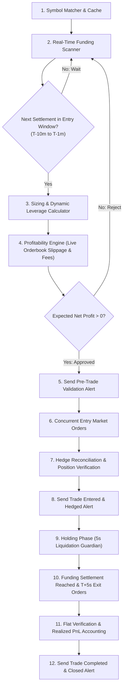

# Cross-Exchange Funding Arbitrage: Strategy & System Architecture

This document provides a clear, comprehensive explanation of the **Single-Cycle Delta-Neutral Funding Arbitrage Strategy** and the autonomous trading engine built to execute it across **Binance Futures** and **Bybit Unified Perpetuals**.

---

## 1. What is Funding Arbitrage in Simple Terms?

In perpetual futures markets, contracts do not expire. To keep the perpetual contract trading price pegged to the underlying spot index price, exchanges enforce periodic **Funding Rate** payments between buyers (Longs) and sellers (Shorts):

* When the funding rate is **positive** ($+$): **Longs pay Shorts**.
* When the funding rate is **negative** ($-$) : **Shorts pay Longs**.

Because Binance and Bybit operate independent order books with different user bases and liquidity profiles, funding rates frequently **diverge**:
* **Binance**: $+0.45\%$
* **Bybit**: $+0.05\%$
* **Funding Edge (Spread)**: $+0.40\%$ for this settlement epoch

---

## 2. How the Bot Makes Profit Without Market Risk (Delta-Neutral)

To collect this funding spread without taking any directional price risk, the bot opens two equal and opposite positions at the exact same moment:

```
┌────────────────────────────────────────────────────────┐
│                   THE ARBITRAGE TRADE                  │
│                                                        │
│   Binance (+0.45% Rate):   SHORT $100 Notional of Coin │
│   Bybit   (+0.05% Rate):   LONG  $100 Notional of Coin │
└───────────────────────────┬────────────────────────────┘
                            │
               Market Price Moves Up 10%
                            │
┌───────────────────────────┴────────────────────────────┐
│ • Binance Short PnL:  -$10.00                          │
│ • Bybit Long PnL:     +$10.00                          │
│ ──────────────────────────────                         │
│   Net Price PnL:        $0.00  (Delta-Neutral)         │
└───────────────────────────┬────────────────────────────┘
                            │
             Funding Settlement Epoch (00:00 / 08:00 / 16:00 UTC)
                            │
┌───────────────────────────┴────────────────────────────┐
│ • Binance Short receives funding:  +$0.45              │
│ • Bybit Long pays funding:         -$0.05              │
│ ──────────────────────────────────────────             │
│   Gross Funding Cashflow:          +$0.40              │
│   Roundtrip Taker Fees (4 fills):  -$0.21              │
│   Roundtrip Slippage:              -$0.03              │
│ ──────────────────────────────────────────             │
│   GUARANTEED NET PROFIT:           +$0.16              │
└────────────────────────────────────────────────────────┘
```

**Regardless of whether the crypto market pumps 50% or dumps 50%, the net price change across both accounts is zero.** The bot isolates and pockets the net funding cash flow.

---

## 3. Single-Cycle Lifecycle & Fee Economics

In the single-cycle model, the bot enters right before funding settlement, collects the funding fee at the exact settlement second, and exits immediately.

### Fee Friction & The Net Profit Invariant
Opening and closing both legs involves 4 market order fills:
1. **Binance Entry**: $0.050\%$ taker fee
2. **Bybit Entry**: $0.055\%$ taker fee
3. **Binance Exit**: $0.050\%$ taker fee
4. **Bybit Exit**: $0.055\%$ taker fee
* **Total Taker Fees**: $\approx 0.210\%$
* **Estimated Slippage**: $\approx 0.030\%$
* **Total Friction Drag**: $\approx 0.240\%$ of notional

### The Strict Opportunity Filter:
* If gross funding spread is $\le 0.240\%$, total costs exceed gross funding $\rightarrow$ **Trade is Rejected**.
* If gross funding spread is $> 0.240\%$ (e.g. $0.50\%$, $1.00\%$, $1.57\%$) $\rightarrow$ Net profit is strictly positive $\rightarrow$ **Trade is Approved**.

Because the bot strictly enforces `expectedNetProfitUsd > 0`, it **never executes a trade that loses money to fees**.

---

## 4. How Exchange Timing (8h vs 4h) is Matched

Different coins or exchanges may settle funding on 8-hour, 4-hour, or 2-hour cycles. The bot ensures precise synchronization in `src/market-data/funding-scanner.ts`:

1. **Next Funding Time Query**: The bot queries both Binance and Bybit for the exact millisecond timestamp of the next funding settlement (`nextFundingTime`).
2. **Interval Calculation**: It verifies the interval duration (e.g. 8h vs 4h).
3. **Alignment Verification**:
   ```typescript
   export function areFundingTimesAligned(
     binanceFundingTimeMs: number,
     bybitFundingTimeMs: number,
     toleranceMs: number = 60_000
   ): boolean {
     return Math.abs(binanceFundingTimeMs - bybitFundingTimeMs) <= toleranceMs;
   }
   ```
4. If Binance settles at 08:00 UTC and Bybit settles at 08:00 UTC, the discrepancy is `0` $\rightarrow$ **Aligned**.
5. If Bybit has a 4h coin settling at 04:00 UTC while Binance settles at 08:00 UTC, the difference is 4 hours $\rightarrow$ **Discarded immediately** to prevent unhedged funding exposure.

---

## 5. End-to-End Algorithm Lifecycle (Step-by-Step)



---

## 6. Streamlined Telegram Messaging System

All noisy background spam and routine periodic reports have been removed. Telegram messaging is strictly divided into two distinct categories:

### A. The 3 Automated Trade Lifecycle Alerts
These are sent automatically by the bot as trades execute:

#### 1️⃣ Alert 1: Pre-Trade Validation Signal (Before Entry, T-10m)
```text
⚡ TRADE EXECUTION SIGNAL: ALL VALIDATIONS PASSED ⚡
━━━━━━━━━━━━━━━━━━━━━━
🎯 Selected Pair: POWRUSDT (Binance & Bybit)
🔄 Strategy Direction: SHORT Binance | LONG Bybit
⚖️ Leverage: 10x (Unified across exchanges)

✅ Pre-Trade Validations Passed:
• Aligned Settlement Epoch: Identical Minute
• Dynamic Leverage Cap: 10x approved
• Binance Margin: Required $10.00 USDT verified
• Bybit Margin: Required $10.00 USDT verified
• Net Profit Invariant: +$1.33 USDT (Costs covered)
• Circuit Breaker & Kill Switch: Normal / Active

📊 Detailed Leg Breakdown:
• Binance: SHORT 1,500 POWR (~$100.00 notional)
• Bybit: LONG 1,500 POWR (~$100.00 notional)
• Margin Per Leg: $10.00 USDT
• Total Position Notional: ~$100.00 USDT

💰 Spread & Cash Flow Forecast:
• Gross Funding Spread: 1.5700%
• Expected Funding Payout: +$1.57 USDT
• Est. Total Taker Fees: -$0.21 USDT
• Est. Slippage Friction: -$0.03 USDT
• Net Projected Profit: +$1.33 USDT
━━━━━━━━━━━━━━━━━━━━━━
🚀 Orders submitted concurrently. Will exit immediately after settlement.
```

#### 2️⃣ Alert 2: Trade Entered & Hedged (When Trade is Taken)
```text
🟢 TRADE ENTERED & FULLY HEDGED 🟢
━━━━━━━━━━━━━━━━━━━━━━
🎯 Pair: POWRUSDT (Binance & Bybit)
⚖️ Leverage: 10x | Margin/Leg: $10.00 USDT
💼 Position Notional: ~$100.00 USDT

📥 Live Fills Confirmed:
• Binance: SHORT (SELL) @ $0.0667 (Qty: 1500)
• Bybit: LONG (BUY) @ $0.0668 (Qty: 1500)

⏳ Status: Delta-neutral active. Waiting for settlement at 2026-11-01 20:00:00 UTC
🛡️ Active Guardians: 5-second liquidation guard & margin drift monitor
━━━━━━━━━━━━━━━━━━━━━━
Both legs locked. Will auto-close positions right after settlement.
```

#### 3️⃣ Alert 3: Trade Completed & Positions Closed (When Trade Exits)
```text
🏁 TRADE COMPLETED & POSITIONS CLOSED 🏁
━━━━━━━━━━━━━━━━━━━━━━
🎯 Pair: POWRUSDT
🛡️ Position Status: 100% FLAT (Zero Open Exposure)

💰 Realized Cash Flow & Net Profit:
• Gross Funding Collected: +$1.5700 USDT
• Total Exchange Fees Paid: -$0.2100 USDT
• 🟢 Net Realized Profit: +$1.3600 USDT

✅ Both accounts verified flat. Margin returned to free balance.
━━━━━━━━━━━━━━━━━━━━━━
Bot resumed scanning for the next funding opportunity.
```

---

### B. Interactive Telegram User Commands

You can send any of the following text messages to the Telegram bot at any time (no leading slash required):

| Message / Command | What It Does |
| :--- | :--- |
| **`next`** | Displays the planned trade for the upcoming settlement: candidate symbol, required margin per leg, dynamic leverage, taker fee deduction breakdown, and net profit forecast. |
| **`wallet`** | Live balance query displaying available USDT, margin balance, total wallet balance, open position count, and active maker/taker fee tiers on Binance and Bybit. |
| **`top5`** | Live ranking of the top 5 highest cross-exchange funding spreads across all perpetual contracts, including annualized APR and time to settlement. |
| **`status`** | System health status, uptime, kill switch & circuit breaker state, and today's total realized PnL. |
| **`help`** | Displays the complete interactive command guide and explains all automated alerts. |
| **`test`** | Places and immediately closes a small safe test order ($3.00 notional) to test API keys and connectivity. |
| **`flatten`** | 🚨 **Emergency Panic Button**: Instantly market-closes all open positions across Binance and Bybit to 100% USDT cash. |
